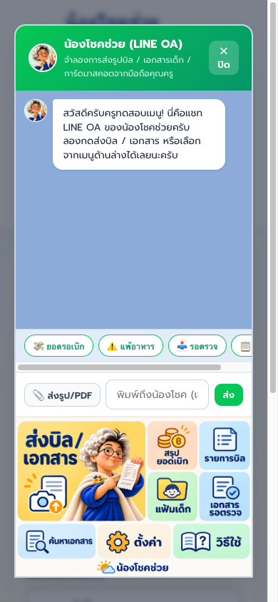
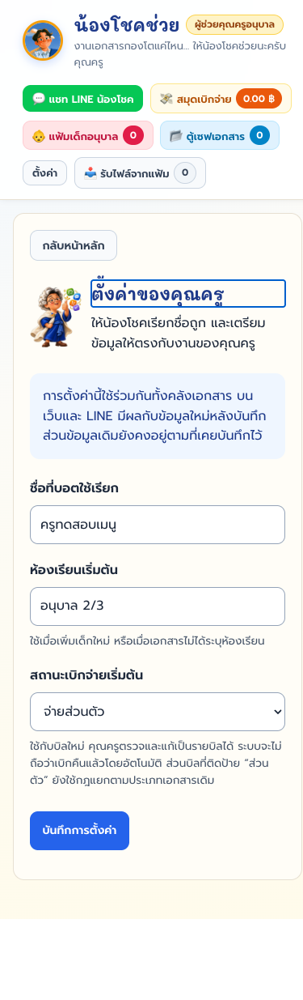
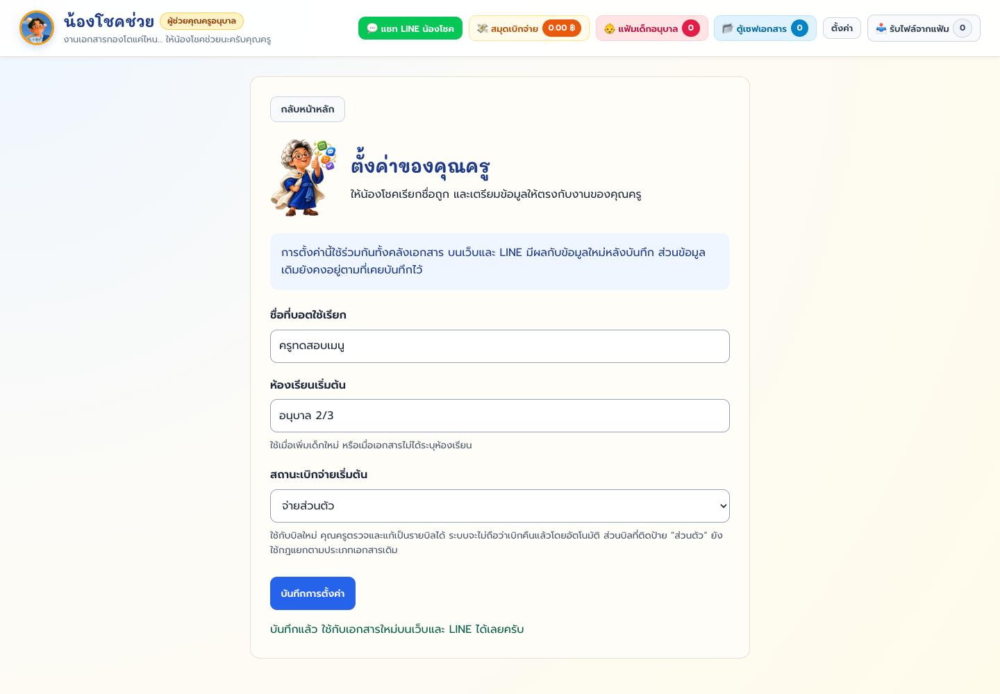

# ตรวจ Rich Menu 8 ปุ่มและการตั้งค่าคุณครู — 2026-11-15

สถานะ: ตรวจในเครื่องสำหรับ PR เท่านั้น ยังไม่ merge/deploy/ติดตั้ง LINE OA จริง

## ผลตรวจ

- Python syntax ผ่านครบโมดูลหลัก รวม `rich_menu.py` และ `scripts/line_rich_menu.py`
- Python unittest discovery ผ่าน **72 ข้อ** รวมทดสอบเดิมและใหม่ 12 ข้อใน `tests/test_rich_menu_settings.py`
- JavaScript syntax (`worker.js`, `static/app.js`) และ Node tests ผ่าน **16 ข้อ** รวมทดสอบหน้า settings, hotspot ทั้ง 8, Camera/Camera Roll ในตัวจำลอง และการรักษาปลายทางหลัง OAuth จำลอง
- `git diff --check` ผ่าน
- คำสั่ง `scripts/line_rich_menu.py build` สร้าง JSON แบบ offline ได้ครบ 8 areas ไม่เรียก LINE API; ภาพ JPEG 1526×1031 px, 316,824 bytes

## สิ่งที่ regression tests ครอบคลุม

- Rich Menu ใช้ภาพและพิกัดเดียวกันทั้ง provisioning/simulator ไม่มีพื้นที่กดทับกัน และไม่กดพื้นที่โลโก้ท้ายภาพ
- Postbacks ทั้ง 5 ส่งผ่าน `/api/line/simulate` ได้คำตอบโดยไม่เรียก LLM ส่วน URI ทั้ง 3 ใช้ origin ที่กำหนดและ `openExternalBrowser=1`
- บันทึก/อ่านชื่อเรียก ห้องเรียน สถานะเริ่มต้น, validation, auth/CSRF และบันทึกผู้แก้ไข; ไม่รับ secret หรือค่า `reimbursed` เป็นค่าเริ่มต้น
- ค่าเริ่มต้นใช้ผ่าน `ocr_service.ingest_document` ทุกช่องทาง และห้องที่ OCR อ่านได้ชัดมีสิทธิ์ก่อน ค่าเก่าไม่ถูกแก้ และ re-extract ไม่เขียนทับสถานะที่ตรวจไว้
- เก็บ Teacher Settings ใน R2 snapshot และกู้ใน data directory ใหม่ได้; manifest commit ล้มเหลวต้องตอบ 503 และค่าที่เคยบันทึกยังอยู่
- กู้ snapshot schema 3 ที่มีข้อมูลเดิม → migrate → บันทึก schema 4; migrate ซ้ำได้; snapshot 4 ที่ขาดตาราง settings ต้องถูกปฏิเสธ
- คำสั่ง install จำลองอ่าน default เดิมก่อน → validate/create → upload ภาพ → activate → verify; upload ล้มเหลวต้องไม่ activate และมี ID ให้ตามเก็บ; restore ไม่ทับ default ที่ release อื่นเปลี่ยนไปแล้ว

## ตรวจหน้าจอด้วย Chromium / Playwright

ใช้เซิร์ฟเวอร์ชั่วคราว `127.0.0.1:8770` กับ `TemporaryDirectory`, `FakeLineOCR` และ `AUTH_REQUIRED=false` เฉพาะ instance ทดสอบ ไม่แก้ `.env`, เซิร์ฟเวอร์หลัก, production หรือข้อมูลจริง

- บน 390×844: กดส่งเอกสารแล้วเห็น Quick Reply ถ่ายรูป/อัลบั้ม, สรุปยอดเบิก, รอตรวจ, ค้นหาแล้วพิมพ์คำค้น, วิธีใช้, รายการบิล, แฟ้มเด็ก และตั้งค่า ไปถึงคำตอบ/หน้าที่กำหนดครบ 8 จุด (รายการในฐานทดสอบเริ่มว่าง)
- บันทึกชื่อ “ครูทดสอบเมนู”, ห้อง “อนุบาล 2/3”, สถานะ “จ่ายส่วนตัว” ผ่านฟอร์ม แล้ว reload และตรวจ API อ่านค่าทั้งสามกลับได้
- ตรวจว่าไม่เกิด horizontal overflow บนหน้าตั้งค่าที่ความกว้าง 390px และตัวจำลองใช้ชื่อที่บันทึกแทนชื่อเก่า
- ตรวจภาพหน้าตั้งค่าทั้ง 1440×1000 และมือถือ; Rich Menu แสดงตามภาพที่อนุมัติพร้อมปุ่มที่มีชื่อสำหรับ keyboard/screen reader
- พบ favicon 404 ใน local browser (ไม่มี favicon ในระบบเดิม) ไม่พบ JavaScript exception จาก flow ที่ทดสอบ

เครื่องมือตรวจดีไซน์แจ้งรายการจากสไตล์เดิม เช่น contrast ของปุ่ม LINE/สีเขียวและแถบสีด้านข้าง KPI รวมถึง placeholder image ที่ยังไม่มี source ไม่ได้แก้สี/องค์ประกอบเดิมนอกส่วน Rich Menu และหน้าตั้งค่าใน PR นี้

## ข้อจำกัดก่อน release

- ยังไม่มีการ merge, deploy หรือเรียก LINE API validate/install/restore จริง
- ยังไม่ทดสอบ Google sign-in ใหม่; การรักษา destination หลัง OAuth ตรวจด้วย Node VM จำลองเท่านั้น
- Chromium ขนาดมือถือไม่ใช่การตรวจบน iPhone/Android จริง ยังไม่ยืนยัน native camera/album, keyboard prefill, per-user/default menu priority หรือการเปิด Safari/Chrome จากแอป LINE จริง
- การตรวจ UI ใช้ OCR จำลอง ไม่ได้ส่งเอกสารจริงใหม่เข้า LINE หรือ LLM
- R2 ใช้ gateway จำลองที่ทดสอบ failure/restore ได้ ยังไม่ได้เปลี่ยนการตั้งค่าหรือ snapshot ของ production
- ก่อน rollback deployment ต้องคงความสามารถอ่าน schema 4 หรือใช้แผนกู้ snapshot ที่เจ้าของอนุมัติ ตาม [คู่มือ Rich Menu](../rich-menu.md)
